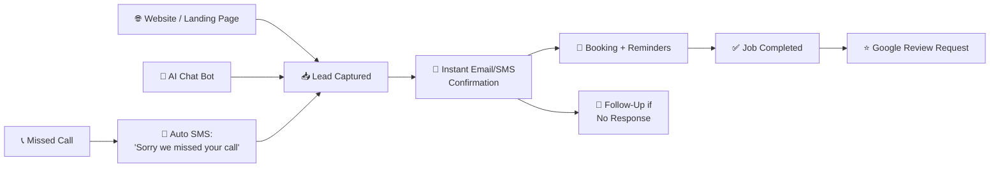
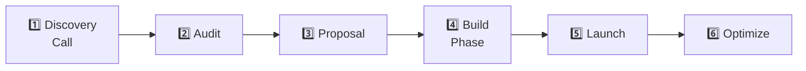

**Websites and automation systems that help local businesses capture more leads, respond faster, and stop losing revenue to missed messages.**

 

 

**Jump to:**
[Overview](#overview) • [Demo](#demo) • [Problem](#problem) • [Services](#services) • [Sales](#sales) • [Pricing](#pricing) • [Tech](#tech) • [Journey](#journey) • [Founder](#founder) • [Contact](#contact)

---

## 🚀 Quick Facts

DeZerraDigital (DZD) is a small-business–focused digital services and automation studio founded by **Dzenan Muratovic**, a Cybersecurity & IST student at UMSL.

| | |
|---|---|
| 🏢 **Business** | DeZerraDigital (DZD) |
| 🎯 **Focus** | Websites + automation for small and local service businesses |
| 💰 **Revenue** | **$15,000+** in custom website sales across multiple client projects (landing pages, full sites, redesigns) |
| 📍 **Stage** | Actively supporting clients, building the portfolio, and maintaining recurring-revenue service packages |

**The 5 core pillars:**

| # | Pillar |
|---|---|
| 1 | 🌐 Website Design & Development |
| 2 | 💬 24/7 AI Live Chat Bots |
| 3 | 📨 Email & SMS Marketing Automation |
| 4 | 📅 Appointment & Scheduling Automation |
| 5 | ⭐ Review Generation & Missed-Call Follow-Up |

> This README is a **central overview** of what DeZerraDigital is and what has been built overall.

---

## 🎬 Demo Walk-Through

https://github.com/user-attachments/assets/8402d8e8-28ab-4f4d-a8e0-d15a2692d8d2

---

## 💡 The Problem DeZerraDigital Solves

| ❌ What small businesses struggle with | ✅ What DeZerraDigital does about it |
|---|---|
| Outdated or DIY websites that **don't convert** | Builds a **professional online presence** |
| Slow or missed responses to leads, especially **after hours** | Automates **repetitive communication** (FAQ answers, follow-ups, missed calls) |
| No structured way to request **Google reviews**, follow up with leads, or stay in touch | Captures and nurtures **every lead** automatically |
| Juggling multiple tools with no automation → **lost time and lost revenue** | Helps owners **make more money with less effort** |

---

## 🧩 What DeZerraDigital Does

### How a lead flows through the system

<b>🌐 1. Website Design & Development</b>

 

**Goal:** Turn a basic online presence into a **lead-generating asset**.

**Done so far:**
- Designed and built **custom websites and landing pages** for local service businesses
- Implemented clear **calls to action** (call, book, get quote)
- Mobile-friendly, responsive layouts
- Simple forms that integrate into automation flows (email/SMS follow-ups)
- Generated **$15K+ in total website sales** from custom website projects

**Typical deliverables:**

| Deliverable | |
|---|---|
| Custom-branded homepage | ✅ |
| Services / About page | ✅ |
| Contact or "Get a Quote" form | ✅ |
| Basic on-page SEO (titles, descriptions, headings) | ✅ |
| Integration with chat bots and lead forms | ✅ |

<b>💬 2. 24/7 AI Live Chat Bot</b>

 

**Goal:** Never miss another question, even at 2 a.m.

**What's implemented:**
- Website-embedded chat bot that:
  - Answers **common FAQs** (hours, pricing ranges, location, services)
  - Captures **name, email, phone number**, and reason for contact
  - Can be configured to **escalate to a human** when needed
- Designed to integrate with email notifications, SMS alerts, and CRM / lead trackers (or lightweight Google Sheets/Notion)

**Benefits:**
- ⚡ Instant responses → better conversion
- 📵 Owners don't have to be glued to their phone

<b>📨 3. Email & SMS Marketing Automation</b>

 

**Goal:** Follow up **every time**, not just when the owner remembers.

**What's been built:**
- Automated flows such as:
  - "Thank you for contacting us" confirmations
  - Follow-ups for quote requests
  - Reminders for consultations or appointments
- Templates for:
  - Welcome messages
  - "We missed you" / "Still interested?" sequences
  - Review requests (paired with the review automator)

**Example flow:**
1. Lead submits a form or reaches out via chat
2. Automation sends an **instant confirmation email/SMS**
3. A **follow-up** message goes out if they haven't responded after X days

<b>📅 4. Appointment & Scheduling Automation</b>

 

**Goal:** Make booking simple and **reduce back-and-forth messaging**.

**What's implemented:**
- Integrated online scheduling tools that let clients:
  - **Choose an available time** from the business owner's calendar
  - Get automated **confirmations** and **reminders**
- Connected with email & SMS confirmation flows and internal notifications for the owner

**Result:**
- 📉 Fewer missed appointments
- ⏱️ Less manual texting and calling just to lock in a time

<b>⭐ 5. Google Review Automator & Reputation System</b>

 

**Goal:** Help businesses build **social proof** on autopilot.

**What's been set up:**
- Automated sequences that:
  - Message customers after a completed job or service
  - Provide a direct link to the **Google review page**
  - Optionally send a **second friendly reminder** if no review was left

**Benefits:**
- ⭐ More 5-star reviews over time
- 📈 Stronger online reputation → more conversions from Google searches

<b>📞 6. Missed Call Check-In & SMS Follow-Up</b>

 

**Goal:** If a customer calls and no one answers, they still get a response.

**What's implemented:**
- Workflows that:
  - Detect a **missed call**
  - Automatically send an **SMS that acknowledges the call**:
    > "Hey! Sorry we missed your call. How can we help you today?"
  - Capture the reply as a **lead** for manual or automated follow-up

**Impact:**
- 🎯 Fewer leads lost to missed calls
- 🤝 Customers feel heard even without an immediate pick-up

---

## 📈 Systems & Sales Infrastructure

Beyond the technical services, DeZerraDigital has built a **repeatable system** for selling and explaining them.

| Asset | What it does |
|---|---|
| 🖼️ **Website previews & mockups** | Show clients what their new site could look like |
| 📊 **Sales slide decks** | Explain the problems local businesses face (missed calls, no automation), the solution stack (website + automations), and simple pricing and ROI |
| 🧮 **Calculators & breakdowns** | Estimate the value of capturing more leads and show how a few extra customers per month can **pay for the service** |

---

## 💵 Pricing & Packaging

DeZerraDigital uses a **"project + recurring"** model: a one-time website build fee, plus an optional monthly plan.

| | Basic | Premium |
|---|---|---|
| **Price** | ~$57/month | ~$227/month and up |
| Site updates | ✅ | ✅ |
| Basic monitoring | ✅ | ✅ |
| Minor content edits | ✅ | ✅ |
| Automation monitoring & tweaks | — | ✅ |
| Chat bot improvements | — | ✅ |
| Funnel testing & adjustments | — | ✅ |

*Exact numbers are adjusted per client. The idea is a one-time build plus recurring automation and support.*

---

## 🧱 Tech & Implementation

DeZerraDigital takes a **tool-agnostic** approach to stay flexible for different clients.

| Area | Approach |
|---|---|
| 🌐 **Websites** | Modern site builders and/or custom **HTML/CSS/JS**, responsive on desktop, tablet, and mobile |
| ⚙️ **Automations** | API-based integrations (email, SMS, forms, schedulers) and logic-based workflows for triggers (form submitted, call missed, etc.) |
| 🛡️ **Security & Reliability** | Cybersecurity-oriented mindset from the founder's background: minimizing attack surface, using reputable platforms, and following best practices |

---

## 🗺️ Example Client Journey

| Step | What happens |
|---|---|
| 1️⃣ **Discovery Call** | Understand business type, services, target customers, and current problems |
| 2️⃣ **Audit** | Review the existing website (if any), Google profile, messaging, and responsiveness |
| 3️⃣ **Proposal** | Bundle website + automation stack; explain price, timeline, and what "done" looks like |
| 4️⃣ **Build Phase** | Draft wireframes and layouts, set up core funnels (forms → email/SMS → follow-up), configure chat bot FAQs and review/missed-call flows |
| 5️⃣ **Launch** | Move the site live, turn on automations, and test from the customer's perspective |
| 6️⃣ **Optimize** | Tweak messaging, adjust automations based on real leads, and help the client collect more reviews and track results |

---

## 🧑‍💻 About the Founder

**Dzenan Muratovic**

- 🎓 Cybersecurity & Information Systems Technology student at UMSL
- 🛡️ Passionate about security-focused, reliable systems
- 💼 Helping small businesses use tech that actually makes them more money
- 🧪 Into automation, networking, and homelab projects

DeZerraDigital is both a **business** and a **portfolio of real-world projects**, showing how technical skills (web, automation, cybersecurity mindset) can directly impact small-business operations.

---

## 📬 Contact

